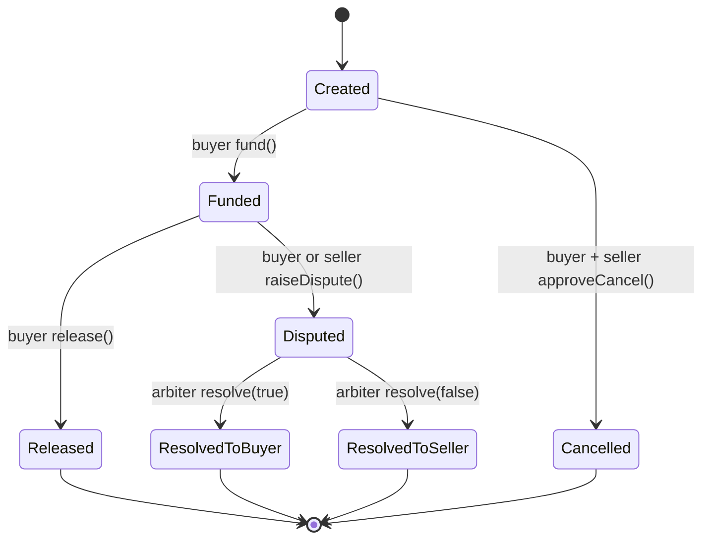

# Assignment 7 - Solidity Escrow

Escrow contract with a buyer, seller and arbiter. Built with Foundry (Solidity 0.8.24).

## Setup
1. Install Foundry: `curl -L https://foundry.paradigm.xyz | bash` then `foundryup`
2. Clone with submodules: `git clone --recurse-submodules <repo-url>`
   (if already cloned: `git submodule update --init --recursive`)
3. `cd Assignment_7`

## Run all tests (one command)
```bash
forge test -vv
```
Includes unit tests for every transition and every rejected transition, plus fuzz tests (1000 runs each).

## Gas report
```bash
forge test --gas-report
```

## Deploy and interact on a local node
Terminal 1:
```bash
anvil
```
Terminal 2:
```bash
forge script script/Interact.s.sol --rpc-url http://127.0.0.1:8545 --broadcast
```
This deploys the contract, runs fund -> release -> withdraw, and prints the contract address, final state and balances. Receipts are in `broadcast/Interact.s.sol/31337/run-latest.json` (a copy is in `receipts/`).

## State machine


## Folder layout
- `src/` contract
- `test/` unit and fuzz tests
- `script/` deploy and interaction script
- `receipts/` local transaction receipts
- `SPEC.md` specification
- `THREAT_MODEL.md` threat model
- `gas-report.txt` gas report